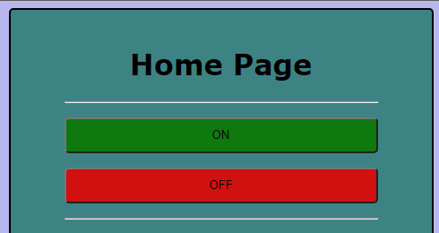
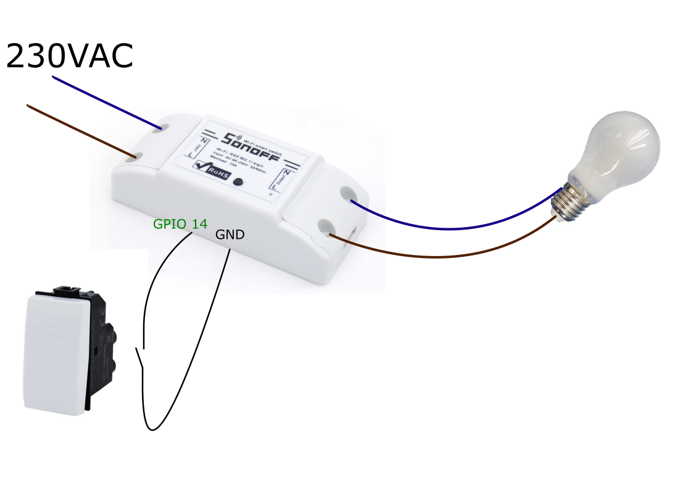
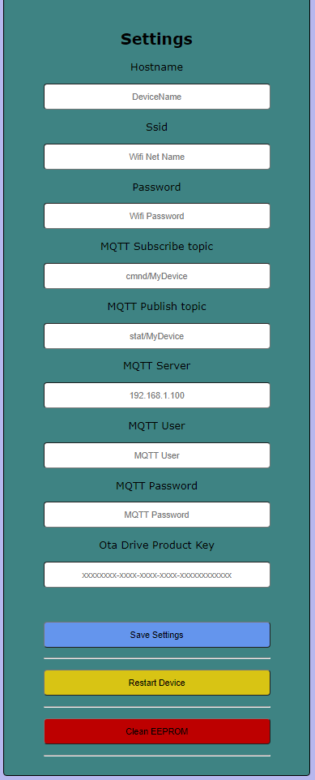

**All In One Sonoff (Switch / LedStrip)**
=======================
One firmware for the Sonoff r1, two uses selectable from the web interface:

- **Switch**: the Sonoff drives a relay (light bulb, wall socket...) from the wall switch, the integrated button, MQTT or the home page.
- **LedStrip**: the Sonoff powers a ws2812b led strip through the relay and drives it on GPIO14 (color, brightness, effects).

The Sonoff can communicate via MQTT protocol with a broker like mosquitto, and in stand-alone mode by accessing the device homepage. Once connected to your wifi network it will be accessible in localhost or at 192.168.4.1 by connecting to its wifi network.

This project merges the old [SwitchSonoff](https://github.com/aletiffi/SwitchSonoff) and [LedstripSonoff](https://github.com/aletiffi/LedstripSonoff) firmwares.

<p align="center">
  
</p>

**Wirings**
-----------------------------------------
GPIO14 has a different function depending on the selected mode:

| Mode     | GPIO14                        | Relay                         |
|----------|-------------------------------|-------------------------------|
| Switch   | Wall switch input (pull-up)   | Load (light bulb, socket...)  |
| LedStrip | ws2812b data line             | Led strip power supply        |

<p align="center">
  
</p>

In LedStrip mode use a power supply suitably sized for the load required by the led strip. The number of leds is set by `NUM_LEDS` in `include/GlobalVar.h` (default 33).

**Setup**
-----------------------------------------
Once the firmware has been loaded, the EEPROM is deleted at the first start, and a default name is assigned to the device.

Once connected to the wifi network named **SonoffAllInOne** (default name) open the browser at 192.168.4.1. Choose the **Device mode**, rename the device then enter the name of the wifi network and the password to which it must connect. The other settings can be entered later. By pressing the `Save Settings` button at the bottom of the page the Sonoff saves the settings, then tries to connect to your network. When the device mode changes the Sonoff restarts.

A device updated from an old firmware keeps its settings and starts in Switch mode.

<p align="center">
  
</p>

The integrated led indicates successful connection to the wifi network.
If the LED does not light up, the network signal may be too weak, to restart the connection process press and hold the button until the LED flashes 2 times.

Now the device is connected to the local network, and it is possible to enter the MQTT parameters through the web page reachable in localhost, by entering `HostName.local` in the browser.

If the **Firmware update url** is set, the device updates itself over the air (see below).

**MQTT**
-----------------------------------------
Commands are JSON messages on the subscribe topic, the state is published on the publish topic (Home Assistant `json` schema, see `doc/Hassio configuration example.yaml`).

- Switch: `{"state": "ON"}` / `{"state": "OFF"}`
- LedStrip: `{"state": "ON", "brightness": 120, "color": {"r": 255, "g": 0, "b": 80}, "effect": "Random"}` (effects: `Solid`, `Random`)

**Firmware update (OTA)**
-----------------------------------------
In the settings enter the url of a small json **manifest** (http or https):

```json
{
  "version": "45.3.0.0",
  "url": "https://drive.google.com/file/d/<BIN_FILE_ID>/view?usp=sharing"
}
```

The device downloads the manifest at the first connection, then every hour, with the integrated button (3 flashes) or with the `Check firmware update` button of the home page. If `version` is newer than the running firmware, the `.bin` at `url` is downloaded and flashed, then the device restarts. The last result is shown in the home page.

Using Google Drive:
1. upload the `.bin` and the manifest (e.g. `manifest.json`, an example is in `doc/ota_manifest.json`) to Google Drive;
2. share both files as "Anyone with the link";
3. put the share link of the `.bin` in the manifest and the share link of the manifest in the device settings. Share links (`https://drive.google.com/file/d/<ID>/view...`) are converted automatically to direct download links;
4. to release a new firmware, upload the new `.bin` and the updated manifest as **new versions** of the same files (Drive: *Manage versions*), so the links don't change.

The same firmware works in both modes, so one manifest can be used by all the devices; a different url per device allows updating them separately (e.g. a test device first). Any other web server works too (GitHub releases, a local nginx...), provided that it reports the `Content-Length` of the `.bin`. Enter `-` in the url field to delete the url.

**Signed firmware**: https downloads are encrypted, but the server certificate is not verified (the device has no root CAs nor a reliable clock). The authenticity is guaranteed by the firmware **signature** instead (RSA 2048 + SHA256, ESP8266 core `Updater`):

- `keys/public.key` is embedded in the firmware, `keys/private.key` signs the `.bin`. They are generated automatically by `scripts/signing.py` at the first build if missing.
- **`keys/private.key` is not committed (`.gitignore`): keep a backup in a safe place.** Without it the devices can only be updated by serial.
- `pio run` writes the signed firmware to `AllInOneSonoff_v<FW_VERSION>.bin`: upload **this** file for the OTA. Unsigned, damaged or differently signed firmwares are refused and the device keeps running the current one (the reason is shown in the home page).
- The build also prints the free space margin for the OTA.

The firmware uses the whole 1MB flash without filesystem (`eagle.flash.1m.ld`) to leave space for the update: devices running an older firmware must be flashed once by serial.

**Integrated button functionality**
-----------------------------------------
While holding the Sonoff button, the LED will flash once per second. Based on the number of flashes reached at release, one of the following functions will be activated.

- 1:  Toggle
- 2:  Connection check
- 3:  Check FW update
- 4:  Show ip address (number of flashes equal to the last IP number)
- 5:  Wifi signal power
- 6:  Load settings (for debug purpose)
- 7:  Save settings (for debug purpose)
- 8:  EEPROM clean
- 9:  Read all EEPROM (for debug purpose)
- 10: Sonoff restart

**Unit tests**
-----------------------------------------
The pure logic (version comparison, Google Drive links, manifest, colors and effects, MQTT messages, settings validation) is in `lib/AppLogic`, without Arduino dependencies, and is covered by the Unity tests in `test/`:

- `pio test -e native`: on the PC, in a few seconds, no hardware needed
- `pio test -e sonoff_sv`: the same tests on the Sonoff connected by serial

GitHub Actions (`.github/workflows/ci.yml`) runs the PC tests and builds the firmware at every push.

**Build**
-----------------------------------------
The project is built with PlatformIO (`pio run`, `pio run -t upload`). The DigiOut, ReadInput and StoreStrings libraries are included in the `lib` folder; ArduinoJson, PubSubClient and FastLED are downloaded automatically.

| Module (`include/*.h`, `src/*.cpp`) | Content |
|------------|-----------------------------------------------------------|
| Config     | Firmware version, pins, timings, sizes (header only) |
| Settings   | Settings and last state, EEPROM load/save, device mode |
| Device     | Relay, status led, on/off/toggle, restart, EEPROM clean |
| WallSwitch | Switch mode: wall switch on GPIO14 |
| LedStrip   | LedStrip mode: ws2812b on GPIO14, color, brightness, effects |
| Button     | Integrated multifunction button |
| Network    | Wifi, access point, mDNS, connection check |
| Mqtt       | MQTT client, commands and state |
| WebUI      | Web server, home page (`HomePage.h`) and http api |
| Ota        | Firmware update from json manifest, signature check |
| `lib/AppLogic` | OtaLogic, ColorLogic, MqttLogic, SettingsLogic: pure logic, unit tested |

Within this repository there is the .bin file to be installed in the Sonoff.
